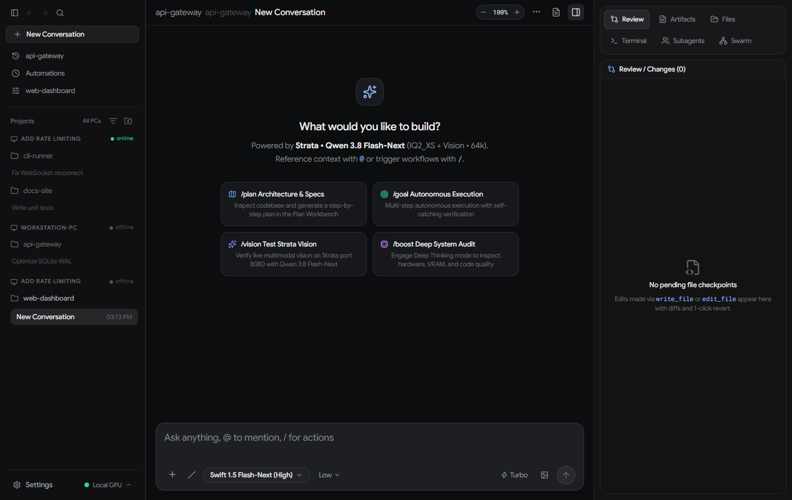
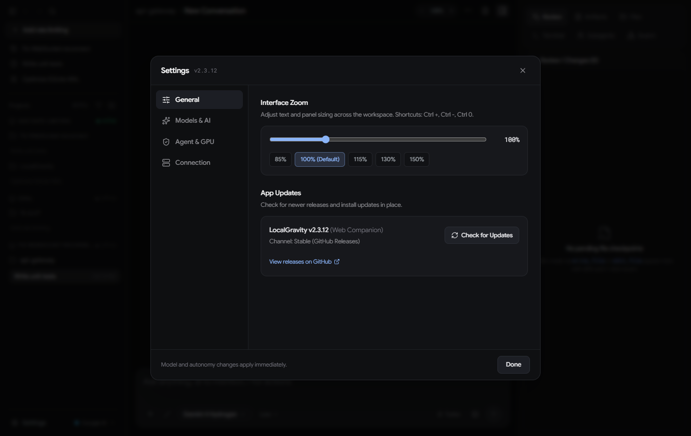
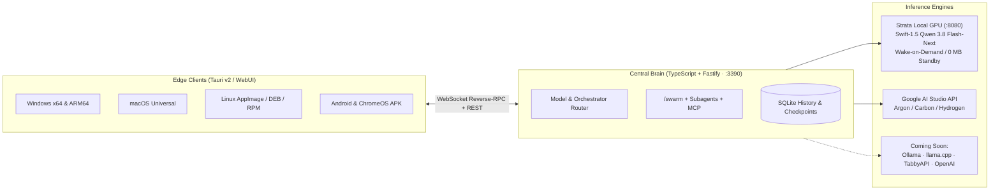

<div align="center">

# LocalGravity

**An independent, local-first agentic coding workspace — built for your own GPU first, with cloud APIs when you want them.**

[](LICENSE)
[](https://github.com/williamcboehmjr/LocalGravity/releases/latest)
[](https://github.com/williamcboehmjr/LocalGravity/actions)
[](#platform-support)

[Why I Built This](#why-i-built-this) · [How It Uses Strata](#how-localgravity-uses-strata-differently) · [Architecture](#architecture) · [Roadmap & `/megaswarm`](#whats-coming-next) · [Quick Start](#quick-start-from-source) · [Contributing](#contributing--feature-requests)

</div>

---

> **Trademark & Non-Affiliation Note:** LocalGravity is an independent hobby project inspired by modern agentic IDE workflows. It is **not** affiliated with, endorsed by, or connected to Google LLC or Google Antigravity. All trademarks belong to their respective owners.

<p align="center">
  
</p>

---

## Why I Built This

I wanted an Antigravity-style coding workspace—real-time thinking and working traces, file review checkpoints with inline diffs, multi-agent swarms, an integrated terminal/editor workbench, and mobile/tablet companion access—that runs **local-first on my own workstation GPU**, while still letting me switch over to cloud APIs (like Google AI Studio) whenever I want extra speed or frontier reasoning.

---

## How LocalGravity Uses Strata Differently

Most local LLM clients treat inference like a static chat box where you manually start a backend server and keep weights pinned in VRAM all day. LocalGravity wires **Strata** (`0.1.58`, port `8080`) into an autonomous workstation daemon (`Central Brain`) with a few key differences:

- **Primary Local Model:** `Swift-1.5-Qwen3.8-Flash-Next-GSQ-RCO-IQ2_XS` (Sparse MoE + Vision, 64k context, `DFlash2` speculative decoding config).
- **Why this model:** It balances fast token generation with native multimodal vision and reliable tool-calling inside consumer VRAM limits, making it practical for multi-step coding loops instead of just single-turn Q&A.
- **Wake-on-Demand & Guaranteed `0 MB` VRAM Standby:** Instead of hogging VRAM 24/7, `LlamaMoESidecar` spawns Strata only when a prompt arrives, polls `/health` until ready, and automatically tears down the port `8080` process after idle timeout (or when you click **Sleep GPU**) so your GPU drops straight back to **0 MB VRAM**.
- **Full Agentic Loop Over Strata's Stream:** Rather than plain chat, `Central Brain` wraps Strata's stream in a multi-step tool loop (`run_terminal`, `read_file`, `write_file`, `edit_file`, `apply_diff`, `grep_search`, `find_by_name`, `capture_screen`, MCP tools, `/swarm`, and auto-compaction) with **Reverse-RPC execution** on whatever client device you're working from.
- **Live Thinking & Interleaved Working Trace:** Reasoning tokens stream into collapsible `Thought for Xs` accordions alongside borderless tool rows, `+X / -Y` diff badges, and interleaved `Working → Prose → Working` updates.

| Capability | Default Strata Client | LocalGravity + Strata |
| :--- | :--- | :--- |
| **GPU Lifecycle** | Manual start/stop; stays in VRAM | **Wake-on-Demand** + auto-offload to `0 MB` VRAM |
| **Execution** | Single-machine chat | **Reverse-RPC** native file edits & terminal across LAN/devices |
| **Workflow** | Single-turn prompt & reply | Multi-step `/plan`, `/goal`, `/swarm`, `/boost`, `/compact` |
| **Workbench** | Chat view only | **3-Pane IDE** (Threads, Trace + Chat, Diff Review / Monaco / xterm) |
| **Cloud Toggle** | Local only | One-click switch to **Google AI Studio** (and more backends coming) |

<details>
<summary><strong>Screenshot: Redesigned Minimalist Settings Modal</strong></summary>
<br />
<p align="center">
  
</p>
</details>

---

## Architecture

LocalGravity splits AI orchestration from native machine execution:



---

## Platform Support

| Platform | Package Formats | Notes |
| :--- | :--- | :--- |
| **Windows (`x64` & native `ARM64`)** | `.msi` + `.sig` | Signed Tauri v2 native installers + in-app auto-update |
| **macOS (Apple Silicon + Intel)** | Universal `.dmg` + `.app.tar.gz` | Single Universal binary built on `macos-latest` |
| **Linux (`x64`)** | `.AppImage`, `.deb`, `.rpm` | Covers Ubuntu, Debian, Arch, Fedora, openSUSE, SteamOS |
| **Android & ChromeOS** | Signed `.apk` | Resizable window + non-touch Chromebook manifest support |
| **Web Companion** | Built-in WebUI | Served directly from Central Brain (`http://<host>:3390`) |

---

## What's Coming Next

- **More Local & OpenAI-Compatible Endpoints:** First-class support for **Ollama**, **llama.cpp** server, **TabbyAPI**, and general **OpenAI-compatible API routing** so you can plug in any local or self-hosted model stack.
- **`/megaswarm` (Experimental Idea):** Something I'm toying with—being able to pull together a big swarm of different cloud and local APIs (**Grok, ChatGPT / OpenAI, Google Gemini, Claude**, and more) all working in unison on the same problem. Great for kicking off a hard project on the right foot, or throwing combined brainpower, horsepower, and speed at a tough bug.

---

## Contributing & Feature Requests

This is a **side hobby project**, so I keep things straightforward:
- **Feature Requests:** Open an issue anytime! I read everything and love hearing ideas, though I can't promise timelines or that every request will make it in.
- **Forks & Pull Requests:** You're more than welcome to fork the repo and submit a PR. Incoming PRs go through AI-assisted code review and safety checks (plus human review) to verify changes make sense and stay safe before merging into `main`.

---

## Quick Start (From Source)

### 1. Start Central Brain
```bash
cd server
npm install
npm run build
npm start
```
Verify health: `http://127.0.0.1:3390/api/health`

### 2. Start the Client (Web or Desktop)
```bash
cd client
npm install
npm run dev        # WebUI at http://localhost:5173
# or
npm run tauri dev  # Native desktop shell
```

Prebuilt installers are available on the [Releases](https://github.com/williamcboehmjr/LocalGravity/releases) page.

---

## Credits & Open-Source Licenses

LocalGravity builds on a lot of great open-source software:

- **Desktop & Mobile Runtime:** [Tauri](https://tauri.app/) (MIT / Apache-2.0), [Rust](https://www.rust-lang.org/) (`tokio`, `tokio-tungstenite`, `serde`, `futures-util`)
- **Frontend UI:** [React](https://react.dev/) (MIT), [Vite](https://vite.dev/) (MIT), [Tailwind CSS](https://tailwindcss.com/) (MIT), [Zustand](https://github.com/pmndrs/zustand) (MIT), [Lucide Icons](https://lucide.dev/) (ISC)
- **Editor, Terminal & Markdown:** [Monaco Editor](https://microsoft.github.io/monaco-editor/) (MIT), [xterm.js](https://xtermjs.org/) (MIT), [react-markdown](https://github.com/remarkjs/react-markdown) & [remark-gfm](https://github.com/remarkjs/remark-gfm) (MIT)
- **Backend & Storage:** [Fastify](https://fastify.dev/) (MIT), [better-sqlite3](https://github.com/WiseLibs/better-sqlite3) (MIT), [ws](https://github.com/websockets/ws) (MIT), [pdf-parse](https://www.npmjs.com/package/pdf-parse) (MIT), [yaml](https://github.com/eemeli/yaml) (ISC)
- **Local Inference & Tools:** Strata local inference runtime, [llama.cpp](https://github.com/ggml-org/llama.cpp) (MIT), [ExLlamaV3](https://github.com/turboderp-org/exllamav3), [Playwright](https://playwright.dev/) (Apache-2.0), and the Model Context Protocol (MCP)

---

## License

MIT License — see [LICENSE](LICENSE) for details.
